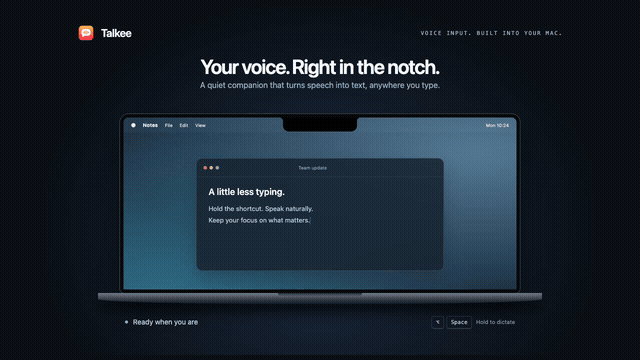
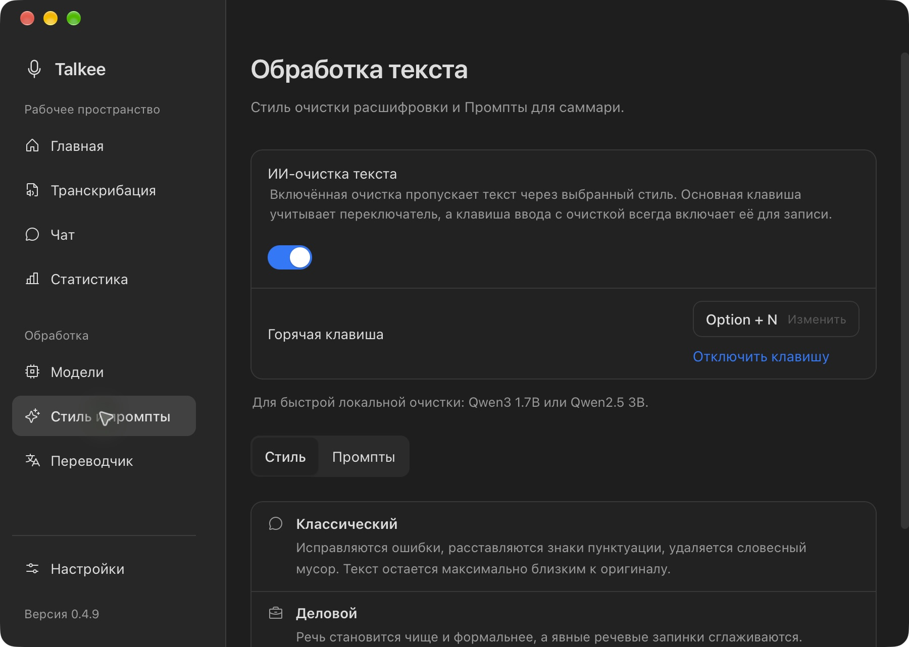
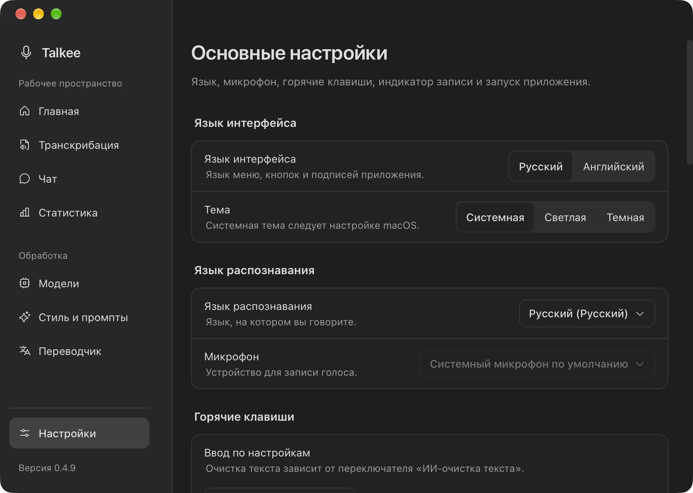
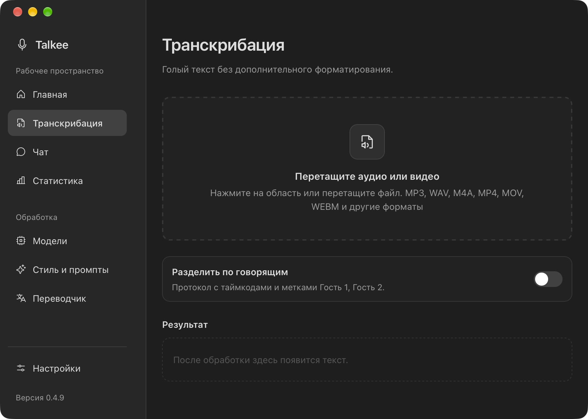

<p align="center">
  
</p>

<h1 align="center">Talkee</h1>

<p align="center">
  Open desktop voice input for people who write in real apps all day.
</p>

<p align="center">
  <a href="README.ru.md">Read in Russian</a>
  ·
  <a href="https://github.com/dibrovnik/talkee/releases/latest">Latest release</a>
</p>

<p align="center">
  <a href="https://github.com/dibrovnik/talkee/releases/latest"></a>
  <a href="https://github.com/dibrovnik/talkee/actions/workflows/check.yml"></a>
  <a href="LICENSE"></a>
  
</p>

<p align="center"><strong>Speak. Talkee transcribes, refines, and pastes.</strong><br>Dictation · audio & video · calls · translation · local models</p>

<p align="center">
  <a href="https://github.com/dibrovnik/talkee/releases/latest/download/Talkee-macos.dmg"><strong>Download for macOS ↓</strong></a> ·
  <a href="docs/privacy.md">Privacy</a> ·
  <a href="CHANGELOG.md">Changelog</a> ·
  <a href="https://github.com/dibrovnik/talkee/issues/new/choose">Report a bug</a>
</p>



*Notch demo using Talkee’s widget component and sample text in a MacBook mockup.*

**Notch island.** Talkee wraps around your MacBook’s camera notch: recording timer, live levels, transcription ticker, and completion — without moving focus away from your work. Switch to the floating pill on any display.

## Screenshots

| Text cleanup | Settings & hotkeys |
| --- | --- |
|  |  |



Real screenshots from the macOS app. The interface supports Russian and English.

## What Is Talkee?

Talkee is a desktop voice-to-text app built with Tauri, React, TypeScript, and Rust. It stays as a small floating widget, records while you hold a hotkey, transcribes your speech, optionally cleans the text with an LLM, and pastes the final result into the app you were using.

It is designed for practical daily work: IDEs, chats, notes, CRM fields, email, files, and meeting transcripts.

## Highlights

- Dictate into any active text field with a global hotkey.
- Use locked recording mode for longer speech without holding the keys.
- Paste cleaned text automatically after transcription.
- Choose your own API key or local STT and text LLM models.
- Translate system audio in real time through a verified Realtime API connection, with optional spoken translation on macOS.
- Translate selected text with a separate configurable global hotkey.
- Transcribe audio and video files from the Files tab or by dropping files onto the widget.
- Record calls with separate microphone and system-audio tracks on macOS.
- Keep local history for voice recordings, file transcriptions, calls, and live translations.
- Chat with the configured text model to search and analyze Talkee records, summarize calls, find tasks, and translate text.
- Run managed local STT through one native `transcribe.cpp` runtime for Whisper, GigaAM, Qwen ASR, NVIDIA Parakeet, plus local text summaries through a managed GGUF LLM runtime.
- Build a native macOS (Apple Silicon) bundle.

## Changelog

See [CHANGELOG.md](CHANGELOG.md) for the full version history.

## How It Works

1. Focus the text field where you want the result to appear.
2. Hold `Shift + Command + Space` on macOS.
3. Speak naturally.
4. Release the hotkey.
5. Talkee transcribes, cleans, and pastes the text.

The hotkey, microphone, language, model source, cleanup style, and app appearance are configurable in Settings.

## Access Modes

| Capability | API | Local |
| --- | --- | --- |
| Dictation, files, and local history | Yes | Yes |
| Streaming dictation | Verified models | Streaming-capable models |
| Selected-text translation | Yes | Yes |
| Speaker diarization | Local diarization kit | Local diarization kit |
| Synchronous translation | Verified Realtime API | No |
| Summaries and prompt processing | With a configured LLM | With a selected local LLM |

The complete data routing, runtime processes, limitations, and failure boundaries are documented in the Russian-language [API/Local mode architecture](docs/architecture/processing-modes.md). Verifiable user behavior is collected in the [product business requirements](docs/business-requirements.md).

### Own API Key

Use an OpenAI-compatible STT endpoint and a separate LLM endpoint for text cleanup. The Models tab also contains API adapter cards for supported providers.

Realtime dictation and synchronous translation are enabled only after the exact provider, model, endpoint, and key configuration passes its connection check.

Supported STT model names include:

- `whisper-1`
- `gpt-4o-transcribe`
- `gpt-4o-mini-transcribe`

### Local Models

Install and run Talkee-managed local models from Settings. Local mode can keep both transcription and transcript summaries on your machine: STT models handle audio, and a separate local text LLM handles summary and prompt-based processing.

Managed local runtimes:

- Whisper, GigaAM GGUF, NVIDIA Parakeet GGUF, and Qwen ASR GGUF through the unified `transcribe.cpp` runtime, default endpoint `http://127.0.0.1:8000`
- Text LLM summaries through the bundled OpenAI-compatible `talkee-llm` runtime backed by GGUF models such as Qwen2.5 Instruct
- Speaker diarization, default endpoint `http://127.0.0.1:8003`

If a default port is busy, Talkee starts the managed runtime on a fallback port and saves the actual endpoint in settings.

## Installation

Download the latest build from GitHub Releases:

- [macOS DMG](https://github.com/dibrovnik/talkee/releases/latest/download/Talkee-macos.dmg)

### If macOS blocks the first launch

Talkee is currently distributed **without paid code signing**, so Gatekeeper shows an "unverified app" warning. This is **not malware**: the source is open (AGPL-3.0) and the builds are produced by the public GitHub Actions workflow in this repo. How to open it:

**macOS** — "Apple could not verify Talkee is free of malware":

1. In the dialog click **Done** (not "Move to Trash").
2. Open **System Settings → Privacy & Security**, scroll down to *"Talkee was blocked…"* and click **Open Anyway**.
3. Confirm with your password or Touch ID and click **Open** again.

Or, in one command in Terminal (after moving it to Applications):

```bash
xattr -dr com.apple.quarantine /Applications/Talkee.app
```

On first launch, grant the permissions Talkee needs:

- Microphone access for recording.
- Accessibility permission for automatic paste.
- Screen and System Audio Recording permission for call recording.

After permissions are granted, Talkee stores the completed onboarding state and
does not reopen native permission prompts on every launch. If an OS permission is
reset or denied later, Talkee asks again only when that access is needed.

## Migrating from Talkis

Talkee was previously released under the name **Talkis**. On first launch Talkee automatically migrates your data from the old app-data directory, so settings, history, audio, and downloaded models are preserved.

- **Migrated automatically:** settings (`talkis.json` → `talkee.json`), transcription history and audio, downloaded local models, and the saved path settings. The migration runs once and never overwrites files already present in the new directory.
- **Grant permissions again:** the bundle identifier changed to `com.talkee.app`, so macOS treats Talkee as a new app. Grant Microphone, Accessibility, and Screen & System Audio Recording again on first launch.
- **Old directory:** `~/Library/Application Support/com.trixter.talkis/`. Talkee copies the data but leaves this directory in place. After you verify that everything works, you can delete it manually to reclaim the space used by models:

  ```bash
  rm -rf ~/Library/Application\ Support/com.trixter.talkis
  ```

  Old logs live in `~/.talkis/` and can be removed the same way.

## File Transcription

The Files tab supports audio and video transcription up to 8 GB. Files are processed through a native path-based pipeline, so large files do not need to be loaded into WebView memory.

Talkee uses the bundled ffmpeg sidecar for video, unsupported audio formats, chunking, and diarization preparation. Ready `16 kHz` mono PCM WAV files can skip conversion for local STT.

Speaker diarization is available through local Whisper plus the local diarization runtime.

## Call Recording

Call recording captures two tracks:

- `You` from the microphone.
- `Call` from system audio.

System-audio capture uses the macOS Core Audio process/system tap.

The call appears in history as soon as recording starts. Talkee checkpoints
both audio tracks and the transcript draft while the call is active. Streaming
STT models show live text in the Transcription tab, then the saved tracks refine
the result after stop. After an unexpected shutdown, Talkee restores available
audio and the latest durable draft on the next launch. GigaAM and other
batch-only models transcribe the call after recording stops.

## Synchronous Translation

Enable the translation button in Settings -> Translation, choose the target language, and start it from the floating widget. API mode uses a verified [OI] or Gemini Realtime adapter. Local mode does not provide synchronous translation, but local dictation, selected-text translation, file transcription, summaries, and other local features remain available.

The live text overlay keeps consecutive chunks from the same source together and stores the finished session in local history. On macOS, OpenAI-backed sessions can also play translated speech while reducing the original source volume.

## Privacy

- In own-key mode, requests go directly to the endpoints you configure.
- In local mode, transcription stays on your machine.
- API keys are stored locally in app settings.
- Voice history and file transcription history are stored locally.
- Talkee has no cloud account, telemetry, or subscription; it does not operate transcription servers.

## Troubleshooting

- Nothing is pasted: check macOS System Settings -> Privacy & Security -> Accessibility and make sure Talkee is enabled.
- Transcription contains unexpected foreign characters: choose a fixed recognition language such as `ru` or `en` instead of auto.
- Local STT returns model errors: open `Модели` -> `Локально`, make sure the model is installed and selected, then reinstall it if the runtime reports missing files.
- Call recording cannot start: grant Microphone and the System Audio Recording permission, then start the call recording again.
- The Dock or Finder still shows the old Talkee icon after an update: macOS caches icons. Run `killall Dock` or re-register the app with `lsregister -f /Applications/Talkee.app` to refresh it.
- Need deeper diagnostics: open `~/.talkee/talkee.log` or run `bun run logs` during development.

## Product And Architecture Documentation

- [API/Local mode architecture](docs/architecture/processing-modes.md) — technical routing for dictation, files, calls, translation, LLM processing, and history.
- [Talkee business requirements](docs/business-requirements.md) — user capabilities, expected behavior, limitations, and acceptance criteria.
- [Audio pipeline principles](docs/audio-pipeline-principles.md) — mandatory engineering rules for recording, STT, files, and call capture.
- [Local STT runtime](docs/local-stt-runtime.md) — managed local recognition architecture and contract.

## Development

Requirements:

- macOS 14+ on Apple Silicon (M1 or later)

- Bun `1.2.x`
- Rust stable
- Tauri v2 system dependencies

Install dependencies and start the app:

```bash
bun install
bun run prepare:sidecars
bun run tauri dev
```

Useful commands:

```bash
bun x tsc --noEmit
cargo check --manifest-path src-tauri/Cargo.toml
bun run check:release
bun run tauri build
bun run build:release:macos

# Local update: quality gate, signed build, backup, replace /Applications/Talkee.app, relaunch
bun run update:local
bun run logs
```

## Project Structure

```text
src/                  React and TypeScript frontend
src/windows/widget/   Floating widget window
src/windows/settings/ Settings window and tabs
src/lib/              Store, auth, permissions, logging, shared clients
src-tauri/src/        Rust backend, Tauri commands, audio, paste, STT
src-tauri/icons/      App icons
docs/                 Architecture, business requirements, release docs, audio rules
scripts/              Release and sidecar preparation scripts
```

For audio, transcription, local STT, file transcription, or call-capture changes, read [docs/audio-pipeline-principles.md](docs/audio-pipeline-principles.md) before editing code.

## Tech Stack

- Tauri v2
- React 19
- TypeScript
- Rust
- cpal native microphone recording
- OpenAI-compatible STT and LLM APIs
- Managed local STT sidecars
- Bundled ffmpeg sidecar

## Contributing

Issues and pull requests are welcome. Before changing audio behavior, read the audio pipeline document and keep enough logging to debug recorder stats, ffmpeg timing, STT endpoint selection, chunk progress, and call-capture levels.

Project conventions:

- UI supports Russian and English.
- Code and comments are English.
- Package manager is Bun.
- Settings are persisted immediately after change.
- Release workflow is documented in [rules/release.rule.md](rules/release.rule.md).

## License

Talkee is licensed under the [GNU Affero General Public License v3.0 or later](LICENSE) (`AGPL-3.0-or-later`).

This license keeps the desktop app open-source and also requires source availability for modified versions that are offered to users over a network.
