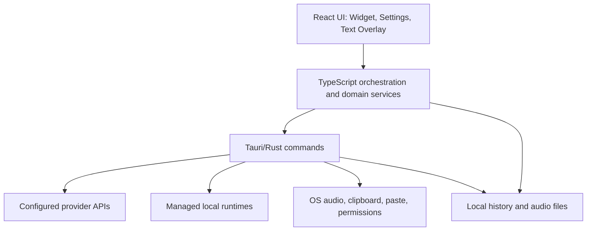

# Архитектура режимов Talkee: API и Локально

Статус: актуальное описание реализации.

Этот документ отделяет техническую логику Talkee от пользовательского и маркетингового описания. Его можно использовать как основу для архитектурного обсуждения, ревью новых функций и проверки того, что один и тот же сценарий одинаково ведёт себя в режимах **API** и **Локально**.

## 1. Главный принцип

Talkee имеет единый интерфейс и общие пользовательские сценарии, но два разных способа выполнения вычислений:

| Режим | Где выполняется обработка | Учётные данные | Основное ограничение |
| --- | --- | --- | --- |
| API | Напрямую через настроенные пользователем endpoints | API-ключи пользователя | Realtime работает только для проверенных конфигураций |
| Локально | В управляемых sidecar-процессах или другом localhost endpoint | Обычно не нужны | Синхронный перевод системного звука недоступен |

Режим определяет маршрут данных, стоимость, приватность и доступность функций. Talkee не должен незаметно переключать пользователя между режимами: такой fallback мог бы изменить место обработки данных или привести к непредвиденным расходам.

## 2. Источник истины активного режима

Режим распознавания и режим обработки текста — независимые величины, и каждая вычисляется своей чистой функцией из сохранённых настроек:

```text
STT endpoint указывает на localhost/127.0.0.1
  -> распознавание Локально

Удалённый или пустой STT endpoint
  -> распознавание через API

Текстовый (LLM) endpoint указывает на localhost/127.0.0.1
  -> обработка текста Локально

Пустой текстовый endpoint
  -> текстовая обработка через API ([OI]-совместимый endpoint пользователя)
```

Переключение вкладки в интерфейсе моделей само по себе не меняет рабочий режим. Новый режим становится активным после явного действия пользователя «Выбрать»/«Использовать». После сохранения публикуется событие обновления настроек, а виджет использует новый snapshot при следующей операции.

Важно: STT и текстовая LLM настраиваются отдельно. Например, в API-режиме распознавание может идти в один endpoint, а очистка текста — в другой. В локальном режиме управляемый STT и локальная LLM также являются разными runtime-процессами. Переключение режима распознавания не переписывает текстовый endpoint, модель и ключ, и наоборот: основной сценарий — локальный Nemotron + DeepSeek API для очистки.

Секция «Распознавание речи» и секция «Обработка текста» в настройках моделей имеют собственные переключатели API/Локально, собственную активную подпись и действия «Выбрать», «Скачать», «Проверить». Смена отображаемой категории меняет только представление: рабочая конфигурация остаётся прежней до явного выбора.

### 2.1 Каталог предложений и совместимость

| Секция | Предложения |
| --- | --- |
| Локальное распознавание | Nemotron 3.5 ASR Streaming 0.6B (основной сценарий, streaming), GigaAM v3 (batch, окно ≤25 секунд), Whisper large-v3-turbo (batch) |
| API-распознавание | [OI] GPT-4o Transcribe, Groq Whisper large-v3-turbo |
| Текстовая обработка | DeepSeek API (основной пресет), локальные Qwen3 1.7B Q4 и Qwen2.5 3B Instruct Q4 |

Каталог предложений намеренно короткий, но техническое распознавание прежних значений остаётся: backend по-прежнему разрешает старые runtime id, GGUF-алиасы и Hugging Face id. Ранее выбранная модель или адаптер показывается отдельно с пометкой «ранее установлено/настроено», её файлы и ключ не удаляются автоматически. Ручная настройка endpoint и модели доступна отдельно от рекомендаций.

## 3. Слои приложения



### 3.1 React/WebView

- `Widget` принимает горячие клавиши, управляет записью, синхронным переводом и состояниями плавающих окон.
- `Settings` хранит настройки моделей, разрешений, перевода, файлов и истории.
- `WidgetTextOverlay` показывает потоковый и финальный текст независимо от основного окна виджета.

### 3.2 TypeScript orchestration

TypeScript выбирает сценарий и backend по snapshot настроек, управляет отменой, объединяет partial/final результаты и обновляет локальную историю. Здесь находятся маршрутизация диктовки, файлов, перевода выделенного текста, summary и поиска по истории.

### 3.3 Tauri/Rust

Rust отвечает за нативную запись звука, системный audio capture, media preparation, вызовы STT/Realtime, управление sidecar-процессами, вставку текста и файловое хранение истории.

### 3.4 Управляемые локальные процессы

- `talkee-stt`: единый [OI]-совместимый `transcribe.cpp` runtime для Whisper, GigaAM, Qwen ASR и NVIDIA Parakeet; базовый endpoint `http://127.0.0.1:8000`.
- `talkee-diarize`: разделение речи по говорящим; базовый endpoint `http://127.0.0.1:8003`.
- `talkee-llm`: [OI]-совместимая GGUF LLM для summary и обработки текста; предпочтительный порт `8011`.
- `talkee-ffmpeg`: конвертация видео и неподдерживаемого аудио, подготовка diarization и чанкинг больших файлов.

Управляемые runtime запускаются только из бинарников, встроенных в сборку приложения. Если встроенный runtime не найден, локальный режим показывает понятную ошибку и не выполняет сетевых запросов. Если заняты стандартные порты, Talkee выбирает fallback-порт и сохраняет фактический endpoint.

## 4. Общий жизненный цикл операции

Для диктовки, файла, перевода или summary используется одна базовая схема:

1. Загрузить актуальный snapshot настроек.
2. Проверить разрешения и конфигурацию выбранного режима.
3. Получить вход: микрофон, системный звук, файл, выделенный текст или запись истории.
4. Выбрать backend без скрытой смены режима.
5. Запустить операцию с идентификатором сессии/запроса и возможностью отмены.
6. Показывать промежуточное состояние, если backend поддерживает streaming.
7. Получить финальный результат и при необходимости выполнить текстовую постобработку.
8. Показать, вставить или сохранить результат в зависимости от сценария.
9. Записать локальную историю и структурированный диагностический лог.
10. При ошибке сохранить предыдущую рабочую конфигурацию и показать пользователю понятное действие для восстановления.

## 5. Техническая матрица возможностей

Обозначения: **Да** — штатно поддерживается; **Условно** — зависит от модели, capability или дополнительного локального компонента; **Нет** — намеренно недоступно.

| Возможность | API | Локально |
| --- | --- | --- |
| Batch-диктовка | Да | Да |
| Потоковая диктовка | Условно: проверенная Realtime-конфигурация | Условно: модель с поддержкой streaming |
| Очистка/переформатирование текста | Да, если настроена LLM | Да, если выбрана локальная LLM |
| Перевод диктовки перед вставкой | Да, если настроена LLM | Да, если выбрана локальная LLM |
| Перевод выделенного текста | Да | Да: локальный переводчик или LLM |
| Транскрибация аудио/видео | Да | Да |
| Разделение файла по говорящим | Условно: локальный STT + diarization | Да, при установленных STT + diarization |
| Запись созвона: микрофон + системный звук | Да | Да |
| Live-текст созвона | Условно: проверенная Realtime-конфигурация | Условно: streaming-модель |
| Синхронный перевод системного звука | Условно: проверенный [OI]/Gemini Realtime | Нет |
| Озвучка синхронного перевода | Условно: [OI], macOS | Нет |
| Summary и пользовательские промпты | Да, если настроена LLM | Да, если выбрана локальная LLM |
| Локальная история и аудиофайлы | Да | Да |
| ИИ-поиск по истории | Экспериментально, dev-сборка | Экспериментально, dev-сборка |

## 6. Диктовка

### 6.1 Захват

```text
Горячая клавиша/кнопка
  -> useWidgetRecording
  -> recordingRuntime
  -> native_voice_recorder (WAV 16 kHz mono PCM16)
  -> WebView MediaRecorder как fallback для выбранных deviceId
```

Нативный WAV-путь является основным: обычная диктовка не должна зависеть от ffmpeg. `MediaRecorder` остаётся fallback для устройств, которые WebView адресует надёжнее по `deviceId`.

### 6.2 Распознавание по режимам

- **API:** Rust вызывает настроенный [OI]-совместимый STT endpoint. Streaming включается только после проверки конкретного adapter/model/endpoint/key fingerprint.
- **Локально:** запрос идёт в управляемый localhost STT runtime. Streaming используется только моделями, для которых он явно поддержан.

Если потоковый канал недоступен, batch-распознавание остаётся основным финальным путём. Для некоторых realtime-моделей финальный batch может уточнить промежуточный текст.

Если ни API-ключ, ни локальная модель не настроены, запись не начинается: виджет показывает сообщение с действием «Открыть настройки моделей».

### 6.3 Завершение

После STT Talkee может применить стиль, очистку или перевод через выбранный текстовый backend. Финальный текст вставляется в ранее активное приложение. Ошибка очистки не должна уничтожать уже полученную транскрипцию: допустим возврат исходного STT-текста с понятным статусом.

## 7. Текстовый backend

`resolveSummaryBackend(settings)` используется не только для summary. Он является общим маршрутизатором текстовой LLM для очистки, промптов, перевода диктовки и LLM-fallback перевода выделенного текста:

1. Настроенный endpoint -> localhost считается локальным, другой адрес — custom API.
2. Собственный API-ключ без endpoint -> стандартный [OI]-совместимый путь.
3. Нет модели или сохранён sentinel `none` -> backend недоступен, управляющее действие блокируется с подсказкой выбрать модель.

Управляемый `talkee-llm` может автоматически перезапуститься только когда сохранён `llmLocalModelId`. Произвольные Ollama/LM Studio endpoints вызываются как внешние локальные серверы и не управляются Talkee.

Длинные тексты обрабатываются map-reduce чанками. Для локальных моделей применяются меньшие лимиты контекста.

### 7.1 Основной API-пресет и режим размышлений

Карточка текстовой модели предлагает пресет **DeepSeek** (`https://api.deepseek.com`, `deepseek-flash`) как основной API-вариант. Выбор пресета заполняет только endpoint и модель: API-ключ пользователя и его собственные значения не перезаписываются, а запрос не отправляется, пока пользователь сам не нажмёт «Тестировать».

DeepSeek включает режим размышлений по умолчанию, поэтому запрос очистки явно отправляет `"thinking": {"type": "disabled"}` — бюджет очистки (8 секунд для API, 12 для локально) не должен уходить на reasoning. Это поле получают только DeepSeek endpoint или модель: другие [OI]-совместимые серверы отклоняют неизвестные параметры, поэтому их тело запроса остаётся прежним. Локальные запросы сохраняют ограниченный `max_tokens`.

API-путь текстовой обработки не запускает и не прогревает локальную LLM: sidecar `talkee-llm` стартует только по явному выбору локальной модели (команда `start_local_llm`), а прогрев при включении очистки выполняется лишь при сохранённом `llmLocalModelId`. Локальный sidecar работает с ограниченным контекстом 4096 и сам отключает thinking для шаблонов Qwen3.

## 8. Перевод

### 8.1 Выделенный текст

Отдельная глобальная горячая клавиша копирует выделение из активного приложения и запускает новый запрос. Новый запрос отменяет предыдущий, очищает старое состояние и сразу заменяет содержимое overlay. Финальный результат автоматически скрывается через десять секунд, если пользователь не закрыл его раньше.

Локальный режим сначала использует выбранный специализированный переводчик (NLLB-200 или OPUS для поддерживаемой языковой пары), затем может использовать локальную LLM. API использует общий текстовый backend.

### 8.2 Синхронный перевод

```text
Системный звук (+ опционально микрофон)
  -> native capture
  -> отдельная Realtime-сессия на каждый канал
  -> partial/final translated events
  -> объединение соседних частей одного говорящего
  -> text overlay + local history
  -> optional translated voice playback on macOS
```

- **API:** поддерживаются только успешно проверенные [OI]/Gemini Realtime adapters.
- **Локально:** запуск блокируется до захвата аудио с явным сообщением о недоступности.

Системный звук переводится всегда. Микрофон можно включить как дополнительный канал перевода; при сохранении аудио он всё равно записывается отдельной дорожкой. Озвучка сейчас доступна для [OI]-backed сессий на macOS, где Talkee исключает собственный процесс из захвата и может приглушить оригинал, чтобы избежать петли.

## 9. Файлы и говорящие

```text
Файл до 8 ГБ
  -> native path, без загрузки всего файла в WebView
  -> probe / conversion при необходимости
  -> chunking
  -> STT
  -> optional diarization
  -> merge / history
```

- Готовый WAV `16 kHz mono PCM16` может идти напрямую в локальный STT.
- Видео, неизвестные форматы, большие файлы и diarization preparation используют `talkee-ffmpeg`.
- В локальном режиме используются локальные STT и diarization runtimes.
- В API-режиме speaker mode является гибридным: он требует локального STT/diarization комплекта, а не произвольной provider diarization API.

Первый найденный говорящий отображается как `Вы` — это детерминированное правило интерфейса, а не биометрическое распознавание голоса. Остальные получают имена `Гость N`; пользователь может свободно переименовать их, и новое имя применяется ко всем сегментам этого speaker ID.

## 10. Созвоны

Созвон записывается в две синхронизированные дорожки:

- микрофон — `Вы`;
- системный звук — `Созвон`.

Нативный system-audio capture:

- macOS: Core Audio system/process tap.

Запись появляется в истории сразу после запуска. Нативные WAV-дорожки и
черновик текста фиксируются каждые пять секунд, поэтому после аварийного
завершения Talkee восстанавливает доступное аудио и последнюю сохранённую версию
текста.

Если текущая STT-модель поддерживает streaming, микрофон и системный звук
распознаются параллельно и показываются во вкладке «Транскрибация» во время
разговора. Сбой realtime-канала не останавливает запись. После остановки дорожки
передаются в файловый pipeline, который уточняет черновик и сохраняет финальный
результат. Batch-only модели, включая GigaAM, выполняют только этот финальный
этап.

В истории дорожки воспроизводятся синхронно, а не как один заранее смешанный
файл.

## 11. История и ИИ-поиск

История голоса, файлов, созвонов и синхронного перевода хранится локально в app data (`history/history.json` и связанные аудиофайлы). Выбранный режим обработки не меняет локальный характер истории.

Экспериментальный чат истории сейчас доступен только в dev-сборке. Его путь:

```text
Запрос пользователя
  -> локальный индекс истории
  -> offline semantic templates + lexical ranking
  -> optional embeddings при совместимом embedding backend
  -> ограниченный контекст с источниками
  -> выбранный API/Local text backend
  -> ответ со ссылками на записи
```

Offline-шаблоны покрывают не конкретные фразы запроса, а классы намерений: проблемы/баги, задачи, решения, идеи, обязательства и риски. Embeddings являются усилением поиска, а не обязательным условием работы.

## 12. Настройки, горячие клавиши и конкурентные запросы

- Настройки загружаются при старте и сохраняются после подтверждённого изменения.
- Горячие клавиши диктовки и перевода проходят одну транзакцию: захват полного аккорда -> нормализация -> проверка конфликта -> регистрация новой -> сохранение -> снятие старой.
- При ошибке новая комбинация откатывается, старая остаётся активной.
- `requestId` и target не позволяют позднему ответу предыдущего запроса изменить новое состояние.
- Для пользовательских операций действует тот же принцип: новый перевод выделения или новый retry не должен ждать исчезновения старого overlay и не должен применять устаревший результат.

## 13. Данные, безопасность и диагностика

| Данные | API | Локально |
| --- | --- | --- |
| Аудио/текст запроса | Передаётся настроенному провайдеру | Остаётся на устройстве |
| Provider key | Хранится локально в настройках | Обычно отсутствует |
| История | Локально | Локально |

Секреты не должны попадать в UI events и логи. Диагностические логи должны содержать режим, endpoint без секрета, adapter/model, session/request ID, этап операции, длительность, chunk index/size, recorder stats и уровни call-capture.

Ошибки классифицируются как минимум на: отсутствие конфигурации, отсутствие разрешения, недоступный runtime/endpoint, timeout, provider authentication, capability unavailable, отмена и ошибка сохранения. Сообщение пользователю должно объяснять следующий шаг, а лог — техническую причину.

## 14. Карта основных исходников

| Область | Основные файлы |
| --- | --- |
| Настройки и определение режима | `src/lib/store.ts`, `src/lib/modelMode.ts`, `src/windows/settings/tabs/model/ModelsTab.tsx`, `src/windows/settings/tabs/settingsTabsTypes.ts`, `src/windows/settings/tabs/SettingsTabs.tsx` |
| Диктовка и вставка | `src/windows/widget/hooks/useWidgetRecording.ts`, `src/windows/widget/services/transcriptionPipeline.ts` |
| Нативная запись | `src-tauri/src/native_voice_recorder.rs` |
| Потоковая диктовка | `src/windows/widget/services/dictationStreamOverlay.ts`, `src-tauri/src/live_dictation.rs` |
| Текстовая LLM | `src/lib/summarize.ts` |
| Перевод выделения | `src/windows/widget/services/selectionTranslation.ts` |
| Синхронный перевод | `src/windows/widget/services/liveTranslation.ts`, `src-tauri/src/live_translation.rs`, `src-tauri/src/realtime.rs` |
| Файлы | `src/lib/fileTranscription.ts`, `src-tauri/src/media/mod.rs` и модули `src-tauri/src/media/` |
| Созвоны | `src/lib/callCapture.ts`, `src-tauri/src/call_capture.rs` |
| История | `src/lib/store.ts`, `src-tauri/src/history_storage.rs`, `src/windows/settings/tabs/MainTab.tsx` |
| ИИ-поиск по истории | `src/lib/devChatHistoryContext.ts`, `src/lib/historyEmbeddings.ts`, `src/lib/offlineHistorySearchTemplates.ts` |

## 15. Решения, которые требуют отдельного обсуждения

1. Нужен ли production-доступ к ИИ-чату истории и какие лимиты/источники должны быть у него по умолчанию.
2. Должен ли API-режим поддерживать provider-native diarization без локальных моделей.
3. Следует ли и Realtime-перевод разделить на независимый селектор: распознавание и текстовая обработка уже выбираются отдельно, а realtime-перевод пока остаётся частью секции распознавания.
